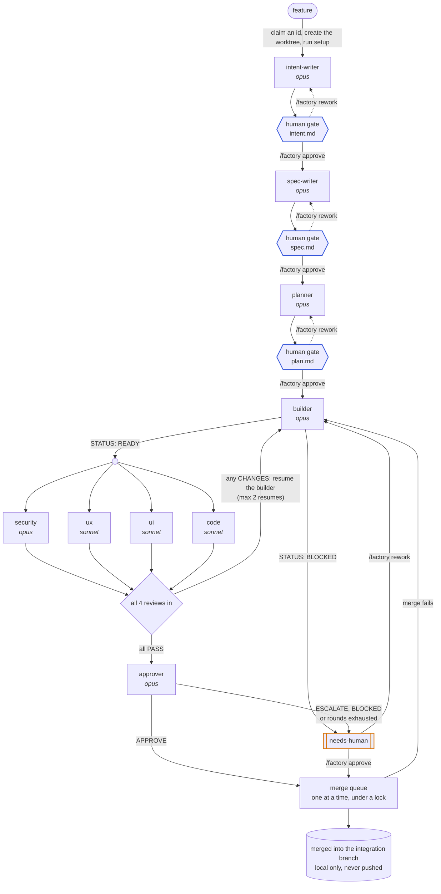

# Software Factory — build prompt

Build a simple, visual "software factory" as a Claude Code plugin in this repo.
Any git repo can install it and run features through it. Keep it small: a viewer
should understand the whole thing in a few minutes.

The plugin holds everything generic: the skill, the agents, the dashboard, a
small mod, and example jobs. Each target repo holds only its own factory/
folder. Nothing in the plugin may mention a specific repo, stack, or command.
All of that comes from the target repo's factory/project.md, plus its
AGENTS.md / CLAUDE.md when present.

## The orchestrator

The factory is one skill, /factory. The session that runs it orchestrates the
jobs it starts (or is handed with resume). It spawns every agent and is the
only writer of those jobs' job.json. It never writes code, specs, reviews or
approvals itself.

Jobs run in parallel: several in one session (/factory next 3), or one per
session across several sessions in the same repo. That's safe because:
- every job has its own state file, worktree, and ports
- shared things (job ids, backlog items, the merge) are claimed atomically
- MAX_PARALLEL = 3 active jobs across all sessions

## The loop (edit this to change the factory)

## Plugin repo layout

.claude-plugin/
  plugin.json                      # name "software-factory", version, description,
                                   # "types": "./types/index.d.ts"
  marketplace.json                 # marketplace "software-factory" listing this plugin (source "./")
skills/factory/SKILL.md            # the orchestrator: loop, job steps, merge queue, commands
agents/                            # one file per agent in the loop
  intent-writer.md  spec-writer.md  planner.md  builder.md  approver.md
  review-security.md  review-ux.md  review-ui.md  review-code.md
scripts/factory_state.py           # read-only queries over every job.json:
                                   #   active <repo> | queue-head <repo> | next-id <repo>
templates/                         # copied into a repo by /factory init
  dashboard.html  project.md  backlog.md
references/                        # read by the agent /factory init spawns
  verification-skill.md            # how to write a repo's verify-<app> skill (from pstack)
  retro.md                         # how to retro a finished job (from Matt Pocock's skills)
  feature-map-example/             # the feature-map shape it follows
hooks/
  hooks.json                       # { "modules": ["./register.ts"] }
  register.ts                      # the mod: status line + toasts
  register.test.ts                 # run with: claude plugin test .
types/index.d.ts                   # PluginState contract for the mod's $.state
examples/factory/                  # 6 example jobs in different stages, with
                                   # dashboard.html symlinked to templates/
README.md                          # what it is, the loop diagram, install, commands
PROMPT.md                          # this prompt

Plugin agents are namespaced: spawn them as software-factory:<agent>. The skill
is software-factory:factory. Check whether /factory works unprefixed, and
document the long form either way.

## Target repo layout

factory/
  project.md                       # repo facts (committed)
  backlog.md                       # "- [ ] feature" queue (committed)
  dashboard.html                   # copied from the plugin
  .merge.lock/                     # exists only while a merge runs (gitignored)
  jobs/004-reading-time/           # one folder per job (gitignored runtime state)
    job.json                       # this job's state: one writer, its orchestrator
    intent.md                      # each approved by a human at a gate
    spec.md
    plan.md
    plan-feedback.md               # only when /factory rework sent a gate back
                                   # (also intent-feedback.md, spec-feedback.md)
    build.md                       # first line STATUS: READY | BLOCKED
    round-1/                       # one folder per review round,
      review-security.md           # one file per reviewer
      review-ux.md
      review-ui.md
      review-code.md
      human.md                     # only when /factory rework added a note
    decision.md                    # first line APPROVE | ESCALATE
../<repo>-factory/<job-id>/        # the job's worktree, OUTSIDE the repo, on factory/<job-id>

Job state always lives in the main checkout, never in a worktree.

## Worktrees
- Run `git worktree add -b factory/<id> <abs worktree> <integration>`, with the
  worktree at `$(dirname REPO)/<repo-name>-factory/<id>`. It's outside the repo
  so the project's tools (bundlers, test runners, watchers) never scan it.
- Run project.md's Setup command (a real install) in the worktree. Symlinking
  the main checkout's dependencies is an explicit opt-in in project.md, because
  a package a builder adds would otherwise land in the main checkout.
- Ports: with n the job number, the builder gets 5100+10n, review-ux 5101+10n,
  review-ui 5102+10n and the approver 5103+10n. They're used only when
  project.md's Browser check or Verification isn't `none`.
- Proof from the running app goes to `<job folder>/evidence/<role>/`, outside
  the worktree, so it never dirties the job branch.
- **Every agent starts every Bash command with `cd <worktree> && `,** because
  the shell returns to the main checkout after each command. Agents give
  Read/Edit/Write/Grep/Glob absolute paths, and write only their own file in
  the job folder.

## job.json
{ "id": "004-reading-time", "title": "Reading time on posts", "feature": "<verbatim>",
  "branch": "factory/004-reading-time", "worktree": "/abs/my-app-factory/004-reading-time",
  "stage": "review", "round": 2, "resumes": 1, "port": 5140,
  "builderAgent": "builder-004-reading-time", "approvedAt": null,
  "updated": "<ISO>", "note": "",
  "gate": null, "gates": { "intent": "<ISO>", "spec": "<ISO>", "plan": "<ISO>" },
  "history": [ { "security": "CHANGES", "ux": "PASS", "ui": "n/a", "code": "PASS" } ],
  "reviews": { "security": "pending", "ux": "PASS", "ui": "n/a", "code": "PASS" } }

- Stages: queued, intent, human-review, spec, plan, build, review, approval,
  merging, merged, needs-human. The active stages are intent, spec, plan, build,
  review, approval and merging. human-review is not active: a job waiting for a
  human holds no slot.
- `gate` is the gate a human-review job waits at (intent, spec or plan).
  `gates` holds when the human approved each one.
- `reviews` is the current round. `history` holds finished rounds. `note` is
  one line for the board.
- Write it atomically (job.json.tmp, then mv) on every change, including each
  verdict as it lands.

## Job steps
1. **Claim.** Get the next id from `factory_state.py next-id`, plus a 2–4 word
   slug. Claim it with `mkdir factory/jobs/<id>` (no -p). If that fails,
   another session took the number: try the next one. Start at stage queued.
2. **Slot.** Start only while `factory_state.py active` is below MAX_PARALLEL.
   Otherwise wait in the background (`until …; do sleep 15; done`). Never poll agents.
3. **Worktree and setup** (stage intent). If setup fails, go to needs-human.
4. **intent-writer,** then the intent gate.
5. **spec-writer,** then the spec gate.
6. **planner,** then the plan gate. At each gate the job goes to human-review
   with `gate` set, and the orchestrator tells the user the file to read and the
   two commands. `/factory approve` records the time in `gates` and moves on
   (after waiting for a slot); `/factory rework` appends the note to
   `<gate>-feedback.md` and re-spawns the same agent. The builder never runs
   before the plan gate is approved.
7. **builder,** named `builder-<id>`, so it can be resumed with SendMessage.
   Then the build check: `STATUS: READY` → review; `STATUS: BLOCKED` →
   needs-human, with the reason.
8. **Review round N.** Spawn all four reviewers in one message, and record each
   verdict as it lands.
9. **WAIT FOR ALL.** A round is done only when all four review files exist.
   Never resume the builder mid-round.
   - Any CHANGES and resumes left: resume the same builder, pointing it at the round folder.
   - Any CHANGES and no resumes left: the orchestrator writes `decision.md` itself
     (`ESCALATE` + "Review rounds exhausted…"), and the job goes to needs-human.
10. **Approver.** APPROVE → stage merging, with `approvedAt` set. ESCALATE → needs-human.
11. **Merge.**
   1. Wait until the job is the queue head (oldest `approvedAt`, from
      `factory_state.py queue-head`) and it holds the lock
      (`mkdir factory/.merge.lock`, owner file inside). A lock whose owner
      isn't merging is stale.
   2. The main checkout must be clean (`git status --porcelain`, ignoring
      factory/backlog.md) and on the integration branch. Otherwise the job goes
      to needs-human with the note "approved; main checkout busy".
   3. Merge the integration branch into the job branch in the worktree and
      re-run Verify. On a conflict or failure, the first time: resume the
      builder, then a fresh review round. The second time: needs-human.
   4. `git merge --no-ff`, remove the worktree, `git branch -d`, release the lock.
- Never push. Never touch the production branch.
- If the builder can't be reached with SendMessage, for example after a
  restart, spawn a fresh builder-<id> told to read intent.md, spec.md, plan.md,
  build.md and every round folder.

## Agents (what each must do beyond the loop)

All agents:
- read project.md and AGENTS.md / CLAUDE.md first
- follow the worktree rules above
- write exactly one file, and never edit anything else

- **intent-writer** writes intent.md in plain language for a human: the
  request verbatim, the problem, who it is for, the desired outcome, how we
  will know it worked, constraints, and open questions (each with the answer
  it will assume). No code, no plan.
- **spec-writer** reads the approved intent.md and keeps the spec consistent
  with it. It writes spec.md with these sections:
  - `> Feature: <verbatim>`
  - `Type: feature | bug`, and for a bug a **Symptom** section: what the user
    does, sees and expected, and where the spec-writer saw it
  - Context (real paths, patterns to reuse)
  - Requirements
  - Acceptance criteria: 3–7, each with a Check that someone who only has the
    repo can run (a command, or a page and what it shows)
  - Out of scope
  - **Assumptions**: decisions made where the request was ambiguous

  It prefers the smallest change, and asks for tests only if the repo has a runner.
  For a bug, AC-1 is "the symptom is gone", and it describes the symptom, not a cause.
- **planner** reads the approved intent.md and spec.md and the code, and writes
  plan.md: Approach, Files (change / add / delete), ordered Steps, a
  Verification line for each acceptance criterion, and Risks. No code beyond
  short signatures.
- The three of them, when re-spawned by `/factory rework`, read
  `<gate>-feedback.md` and rewrite their file to address it.
- **builder:**
  - checks the current branch first
  - reads intent.md, spec.md and plan.md, follows the plan, and records each
    deviation from it, and why, in build.md's Log
  - matches the surrounding code, and makes the simplest change that meets the
    spec, with no new dependencies unless the spec asks
  - runs Verify, linting and format-checking **only the changed files**, never
    a repo-wide --fix
  - commits small, with explicit paths (never `git add -A`), and leaves
    `git status` clean
  - writes build.md with these sections: `STATUS: READY | BLOCKED`, Summary,
    Acceptance criteria with evidence, Validation, and a per-round Log that
    answers every review finding
  - with a port, looks at the running app (see Browser check and Verification)
  - **fixes a bug with a diagnosis loop** (adapted from Matt Pocock's
    diagnosing-bugs): before reading code for a theory, it builds one command
    that fails on the spec's exact Symptom, deterministically, in seconds; then
    shrinks the repro, ranks 3–5 falsifiable hypotheses, writes a regression
    test first when a seam reaches the bug, and fixes it until the same command
    passes. No loop → BLOCKED with what it tried. build.md gets a Diagnosis
    section: loop, failing output, hypotheses, cause, passing output, regression test
- **reviewers** (security opus; ux, ui, code sonnet):
  - read spec.md, build.md and the diff (`git diff <integration>...HEAD`)
  - **from round 2 on, check their own previous round's findings**
  - judge only this change; pre-existing problems go under Notes
  - write a file starting `VERDICT: PASS` or `VERDICT: CHANGES`, then
    `## Findings` (`path:line`, problem, impact, fix; "None." when empty) and
    `## Notes`
  - ux and ui may write just `VERDICT: PASS (n/a)` when nothing in the change
    is user-facing
  - code re-runs Verify
  - ux and ui, with a port, look at the running app (see Browser check and Verification)
  - checklists:
    - **security:** access control, input handling and injection, XSS, data
      exposure, payments and identity, abuse and rate limits, secrets,
      dependencies, guardrails
    - **ux:** flows, loading/empty/error states, each user type, copy,
      accessibility, phone width
    - **ui:** consistency with the visual language and theme tokens, layout at
      phone and desktop widths, contrast and focus, dark mode, hard-coded values
    - **code** (two axes, adapted from Matt Pocock's code-review, kept apart and
      never ranked against each other):
      - Spec: requirements missing or partial, behavior not asked for, behavior
        that's wrong, and for a bug a loop that asserts the real Symptom.
        Each finding quotes the spec line
      - Standards: correctness, documented conventions, debug leftovers, tests
        where the repo can test (a tautological test doesn't count)
      - Fowler's 12 code smells, only as "possible <smell>" Notes, never blocking
- **approver:**
  - APPROVE only if all of these hold: every criterion is met with convincing
    evidence (**it spot-checks at least one itself**); the final reviews are
    PASS or n/a with no real problems in their Notes;
    `git merge-tree --write-tree <integration> HEAD` shows no conflicts
  - ESCALATE for: guardrail paths; money, access or identity; deploy, CI,
    hosting or build scripts; schema migrations, email, production data, new
    dependencies; any spec Assumption that is really a product decision
  - **proves the change is safe** (adapted from pstack's blast-radius): says
    what the change really does, names the one fact it's safe because of,
    looks where grep stops (library source, timing, data across boundaries),
    and proves the fact on a scale: 1 stated, 2 pointed at `path:line`,
    3 walked, 4 ran real code (a throwaway script in the worktree, deleted
    afterwards, or a test), 5 reproduced in the running app. APPROVE needs
    step 4 or 5. Step 3 is enough only when nothing in the change can run
    (docs, comments, content text). For a bug, it re-runs build.md's loop
    (it must pass, and its "before" output must show the spec's Symptom). Otherwise ESCALATE with
    `safety fact unproven: <fact>`. Confirmed risks that matter also escalate.
  - writes decision.md: `APPROVE | ESCALATE`, a one-line reason (shown on the
    board), then Why, Acceptance criteria, Safety fact (step and pasted proof),
    Risks (confirmed and cleared), and For the human

## Browser check (optional)
When project.md sets `Browser check: agent-browser`, the builder, review-ux and
review-ui:
1. start the Dev server in their worktree on their port
2. look at the pages with agent-browser, running `agent-browser skills get core`
   first and passing `--session <job-id>-<role>` on every call
3. never sign in or submit forms
4. close the session and stop the server afterwards

With `none`, they work from the code alone.

## Verification (optional)
project.md's Verification names a project skill (e.g.
`.agents/skills/verify-<app>/SKILL.md`) that launches and drives the app, or
`none`. /factory init can generate one: it spawns a general-purpose agent that
follows references/verification-skill.md (adapted from pstack's
create-verification-skill). The generated skill:
- takes `{worktree}`, `{port}`, `{session}` and `{evidence}` as inputs, and
  keeps each run's state isolated, so parallel jobs never collide
- has Safety, Launch, Doctor, Drive, Evidence and Cleanup sections, and a
  feature map with one file per user-facing feature
- is proven end to end once before init records it

When it's set, the builder, review-ux, review-ui and the approver read it from
the main checkout and follow it with their own port and session
(`<job-id>-<role>`), driving every entry point the map lists for an affected
feature. They sign in or submit forms only when its Safety line says the
instance is local and seeded. If Doctor fails, they fall back to Browser check.

## Commands
/factory init                    copy the templates into factory/ (never overwrite
                                 project.md or backlog.md; a re-run refreshes only
                                 dashboard.html and repeats the Verification offer),
                                 fill in project.md by inspecting the repo, offer
                                 to generate a verification skill, gitignore
                                 factory/jobs/ and factory/.merge.lock, suggest
                                 (don't make) a CI paths-ignore for factory/**,
                                 and tell the user to commit project.md
/factory <feature>               run a new job through the loop
/factory next [N]                N ≤ 3. Each job runs to its first human gate. Claim each item with one exact-line Edit
                                 ("- [ ] x" → "- [x] x → claimed", then the job id).
                                 If the Edit fails, another session took that item:
                                 re-read the backlog and try the next one.
/factory approve <job-id>        human-review: record the gate's time in `gates`, then
                                 the next step (intent → spec → plan → build).
                                 needs-human: → merging (approvedAt now) → Merge
/factory rework <job-id> <note>  human-review: append the note to <gate>-feedback.md and
                                 re-spawn that gate's agent, then back to the gate.
                                 needs-human: write the note to
                                 round-<round+1>/human.md, reset resumes, resume the
                                 builder, then the build check and a review round in
                                 that folder.
/factory resume [job-id]         show each unfinished job's stage and how long since its
                                 last update, confirm no other live session drives it,
                                 then continue from the first missing artifact or
                                 unapproved gate (intent, spec, plan, then build …)
/factory retro [job-id]          merged or needs-human jobs only (default: the most
                                 recent one). A general-purpose agent follows
                                 references/retro.md: reads the job folder and the
                                 session transcripts, and writes JOB_DIR/retro.md with
                                 suggestions ranked by severity for project.md, the
                                 repo's checks, the verification skill and the plugin's
                                 agents. It edits nothing else; the user picks what to apply

The orchestrator posts one short line per transition, and ends with a summary:
what merged and is ready to push, and what needs a human and why.

## project.md (templates/project.md)
Sections that /factory init fills in by inspecting the repo (manifests,
lint/format/test configs, CI workflows, branches, README, AGENTS.md/CLAUDE.md),
running each command once to record what really happens:
- Stack.
- Branches: integration and production, and which pushes deploy. If there's no
  obvious integration branch, ask. Never default to production.
- Setup: the fresh-checkout command (or an explicit "symlink <folder>" opt-in).
- Verify: test, lint (changed files), format check (changed files), and build,
  each with a plain note when it's missing or broken locally.
- Dev server: a command with a {port} placeholder, or none.
- Browser check: agent-browser only if it's installed and the dev server works.
  Otherwise none.
- Verification: the path of an existing verify-* skill that takes a port, or
  one generated on the user's yes (see Verification), or none. A re-run of
  init offers this again, and that line is the only thing it changes in an
  existing project.md.
- Conventions.
- Guardrails: "never commit secrets, never push, never touch production", plus
  the paths the approver must escalate.

## Dashboard (templates/dashboard.html)
One self-contained HTML file with no external scripts and a tiny inline
markdown renderer. Serve it with `python3 -m http.server 8000 --bind 127.0.0.1` from factory/ (localhost only: job files include security findings).
- Every 2s it lists jobs/ (from the server's directory index) and reads each
  job.json. It keeps the last good copy if a file is mid-write. A missing
  jobs/ folder means no jobs yet; a network error means the server is offline.
- Jobs are cards that move across columns: Queued → Intent → Spec → Plan →
  Build → Review → Approval → Merge queue → Merged. The merge queue is the
  merging jobs ordered by approvedAt. Two highlighted lanes sit on top:
  awaiting human review (each card names its gate) and needs-human.
- Each card shows title, id, branch, round, queue position, time since its last
  update, and its note.
- Each review round shows as a row of reviewer chips (pending / PASS / n/a /
  CHANGES) that fill in as verdicts land.
- The header shows active jobs out of the cap and the merge queue.
- Click a card to open a side panel. Its files come from the job folder's
  listings, ordered intent, spec, plan (each followed by its feedback file), build, round-N (human, security, ux, ui, code), then
  decision. Each tab has a verdict/status dot, and the file is rendered.
- Clean and minimal: light and dark mode, keyboard accessible, no horizontal page scroll.

## Mod (hooks/register.ts)
Load the plugin-authoring skill first and follow its conventions and types.
- On session.start, if <cwd>/factory/jobs exists, read every jobs/*/job.json
  with $.fs every 2s via $.clock.every.
- Status line, via $.ui.status:
  `factory ▸ 2/3 running · 1 in review · 1 awaiting review · 1 queued · 1 needs-human`.
  Clear it when idle.
- Toasts, via $.ui.toast, on transitions only: a job enters human-review
  (naming the gate), a job enters needs-human, a job
  merges, a job goes from merging back to build (merge failed). Keep the
  last-seen stages in $.state so a reload doesn't toast again. A job first seen
  mid-flight, for example one started by another session, is recorded without a toast.
- Read-only.
- register.test.ts covers:
  - the status text, including jobs awaiting human review
  - the gate toast
  - one toast per transition, with no repeats
  - a new job from another session
  - silence when factory/jobs is absent

## Verify the plugin
- `claude plugin validate .` and `claude plugin test .` pass.
- A headless session with `--plugin-dir .` lists the 9 software-factory:* agents
  and the skill.
- `examples/factory` served with http.server renders in a browser:
  - columns, chips and the needs-human lane
  - the file panel with no 404s
  - light and dark mode
  - phone width
- factory_state.py gives the right answers on sample jobs, including a half-written job.json.
