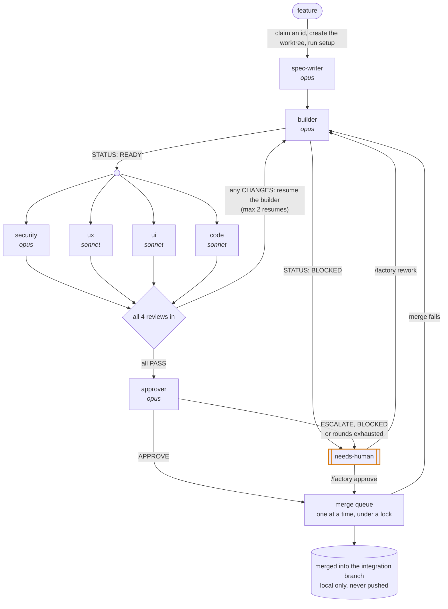

# software-factory

A small, visual software factory for Claude Code. `/factory` takes a feature
through a fixed loop of agents (spec → build → four parallel reviews → approval
→ merge queue). Each job gets its own git worktree. Up to 3 jobs run at once,
in one session or several. A browser board and a status line show where
everything stands.

Inspired by [ZazenCodes' software factory](https://github.com/zazencodes/zazencodes-season-3/tree/main/src/software-factory-claude-code).
See [Credits](#credits).



## How it works

- **The session that runs `/factory` orchestrates its jobs.** It spawns every
  agent and is the only writer of each job's `factory/jobs/<id>/job.json`.
- **Agents talk through files.** Each one reads `factory/project.md` (and
  `AGENTS.md`/`CLAUDE.md`), then writes exactly one file in the job folder:
  - `spec.md`
  - `build.md`, whose first line is `STATUS: READY` or `BLOCKED`
  - `round-N/review-*.md`, whose first line is a verdict: `VERDICT: PASS`,
    `CHANGES` or, for UX/UI only, `PASS (n/a)` (see [Review verdicts](#review-verdicts))
  - `decision.md`, whose first line is `APPROVE` or `ESCALATE`
- **Each job has its own worktree** at `../<repo>-factory/<id>` on branch
  `factory/<id>`. The worktree is outside the repo, so your tools never scan
  it, and it gets a real dependency install. It also gets its own dev-server ports.
- **Safe in parallel.** One state file per job means no two sessions write the
  same file. Job ids and backlog items are claimed atomically, and merges take a
  lock. `MAX_PARALLEL = 3` applies across all sessions.
- **Reviews:** a round is done only when all four files exist. Reviewers check
  their own previous round's findings. Any CHANGES resumes the same builder.
  After 2 resumes, the job escalates.
- **Approval:** the approver spot-checks a criterion and checks
  `git merge-tree` for conflicts. It also names the one fact the change is
  safe because of, and proves it by running real code: a throwaway script, a
  test, or the running app. A fact it can't prove that way means ESCALATE. It
  also escalates guardrail changes and spec assumptions that are really
  product decisions.
- **Merge:** one job at a time, only when the main checkout is clean and on the
  integration branch. The job's branch is brought up to date and re-verified
  first. **Nothing is ever pushed, and the production branch is never touched.**
  See [Branches](#branches).

### Review verdicts

Every review file starts with one of three verdicts:

| Verdict | Meaning | Who can use it | Board chip |
| --- | --- | --- | --- |
| `VERDICT: PASS` | Reviewed. Nothing blocks the merge. | All four reviewers | green |
| `VERDICT: CHANGES` | Reviewed. At least one finding must be fixed. The builder is resumed. | All four reviewers | red |
| `VERDICT: PASS (n/a)` | Not applicable. The change has nothing in this reviewer's area, so there was nothing to judge. | **UX and UI only** | grey outline |

`PASS (n/a)` exists because all four reviewers run on every job, and many
changes have no user-facing part: a refactor, a CI tweak, a backend fix. In
those cases the UX or UI reviewer writes that single line and stops. It doesn't
write a review of nothing, and it doesn't invent nitpicks.

The orchestrator and the approver treat `n/a` exactly like `PASS`. The board
shows it as a separate grey chip, so you can tell "checked and fine" from "not
relevant". Security and code always apply to every change, so those two
reviewers must answer `PASS` or `CHANGES`.

For example, in `examples/factory`, `003-contact-rate-limit` adds a rate limit
to a form's submit handler. UI is `n/a`, because nothing visual changed. UX
still does a full review, because users can now see a rejection message.

### Branches

`project.md` names two branches:
- **Integration:** where approved jobs merge, locally. It can be any branch
  except production.
- **Production:** the factory never checks it out, merges into it or resets it.

Jobs branch off the integration branch and merge back into it. A job's branch
is deleted after it merges, so there's no PR per job. Keep your main checkout
on the integration branch, with nothing uncommitted, while jobs merge.
Otherwise approved jobs wait as needs-human until you run `/factory approve`.

Which branch to use:
- **`main`**, if pushing it deploys nothing.
- **A `dev` branch**, if `main` is production.
- **A feature branch**, if you work through pull requests. Set Integration to
  e.g. `feature/checkout`, run several jobs into it, then push it and open one
  PR. Point Integration at the next feature branch when you start it.

## Install

```
claude plugin marketplace add https://github.com/nickdala/software-factory
claude plugin install software-factory@software-factory
```

Then, in the repo you want to run it on:

```
/factory init
```

`init` creates `factory/` and fills in `factory/project.md` by inspecting the repo:
- stack and branches
- setup, verify and dev-server commands, and the browser-check setting
- conventions and guardrails

It also gitignores `factory/jobs/` (runtime state) and `factory/.merge.lock`.
**Review project.md before running jobs**, because every agent trusts it.

**Optional:** install [`agent-browser`](https://github.com/vercel-labs/agent-browser)
and set `Browser check: agent-browser`. The builder and the UX/UI reviewers will
then look at the running app on per-job ports. Each uses its own browser
session, so parallel jobs never drive each other's browsers.

**Optional:** let `/factory init` generate a verification skill
(`.agents/skills/verify-<app>/`). It's a tested recipe for launching the app on
a given port, driving it the way a user does, and capturing evidence, plus a
map of user-facing features. When `project.md`'s `Verification` names it, the
builder, the UX/UI reviewers and the approver follow it rather than working out
the app each time, and they save proof to `factory/jobs/<id>/evidence/`. Run
`/factory init` again in a repo that's already set up to add one later.

**New project?** `init` learns everything from the repo, so build the skeleton
first, yourself or with plain Claude Code: a setup command, a passing test, and
lint. Commit it on an integration branch (see [Branches](#branches)), then run
`init`. Don't scaffold the skeleton through `/factory`: the approver escalates
changes to dependency manifests and CI. `init` never overwrites `project.md`,
so when your commands change later, edit it by hand.

## Watch it

```
cd factory && python3 -m http.server 8000 --bind 127.0.0.1
open http://localhost:8000/dashboard.html
```

The board lists `factory/jobs/` and reads every `job.json`, so jobs from every
session show up. To try it with no jobs of your own:

```
cd examples/factory && python3 -m http.server 8000 --bind 127.0.0.1   # five example jobs
```

In Claude Code, the status line shows something like
`factory ▸ 2/3 running · 1 in review · 1 needs-human`. Toasts appear when a job
needs a human, merges, or fails to merge.

## Commands

| Command | What it does |
| --- | --- |
| `/factory init` | Create `factory/` and fill in `project.md` |
| `/factory <feature>` | Run a new job through the loop |
| `/factory next [N]` | Claim and run the first N (≤ 3) unchecked items of `backlog.md` |
| `/factory approve <job-id>` | Send a needs-human job to the merge queue |
| `/factory rework <job-id> <note>` | Send a needs-human job back to its builder with your note |
| `/factory resume [job-id]` | Pick up unfinished jobs after a session ends |
| `/factory retro [job-id]` | Look back at a finished job and suggest fixes to the factory |

For more throughput, open more sessions in the same repo and run `/factory` in
each. If another plugin also defines `factory`, use `/software-factory:factory`.

## Layout

Plugin (this repo):

```
.claude-plugin/              plugin.json, marketplace.json
skills/factory/SKILL.md      the orchestrator: loop, job state machine, merge queue, commands
agents/                      spec-writer, builder, approver, review-{security,ux,ui,code}
scripts/factory_state.py     read-only queries over every job.json (active count, merge-queue head, next id)
templates/                   dashboard.html, project.md, backlog.md
references/                  how to generate a repo's verification skill (from pstack), how to retro a job
hooks/register.ts            the mod: status line + toasts (tests: register.test.ts)
types/index.d.ts             the mod's state contract
examples/factory/            five example jobs for the board
PROMPT.md                    the prompt that builds this plugin
```

Each target repo:

```
factory/
  project.md                 repo facts every agent reads (commit this)
  backlog.md                 "- [ ] feature" queue (commit this)
  dashboard.html             the board
  jobs/<id>/                 job.json, spec.md, build.md, round-N/*.md, decision.md, retro.md, evidence/ (gitignored)
.agents/skills/verify-<app>/ optional verification skill (commit this)
../<repo>-factory/<id>/      one worktree per active job
```

## Changing the factory

- **The loop:** the diagram and steps in `skills/factory/SKILL.md`.
  `MAX_PARALLEL` and `MAX_RESUMES` are at the top.
- **An agent's checklist or model:** its file in `agents/`.
- **A repo's commands, ports or guardrails:** that repo's `factory/project.md`.

## Credits

This plugin is inspired by the software factory in
[zazencodes/zazencodes-season-3](https://github.com/zazencodes/zazencodes-season-3/tree/main/src/software-factory-claude-code)
by [ZazenCodes](https://github.com/zazencodes). The core idea comes from that
project: one `/factory` skill orchestrating a spec-writer, a builder, four
parallel reviewers and an approver, all talking through markdown files and
shown on a browser board. So do several lessons from running it on a real site:
- one state file per job
- worktrees outside the repo
- `STATUS: READY | BLOCKED` builds
- reviewers re-checking their earlier findings
- the approver spot-checking a criterion and running `git merge-tree`
- race-safe claims of job ids and backlog items

This version packages the idea as an installable plugin. On top of it, it adds:
- `/factory init` with a per-repo `project.md`
- a configurable integration branch instead of `main`
- a cap on parallel jobs, enforced across sessions
- a serial merge queue that re-verifies before merging
- `/factory resume`
- `PASS (n/a)` verdicts, so UX/UI reviewers can skip changes outside their area
- a status line and toast mod

Two pieces come from [pstack](https://github.com/cursor/plugins/tree/main/pstack)
by Lauren Tan (MIT License, Copyright (c) 2026 Lauren Tan):
- `references/verification-skill.md` and `references/feature-map-example/`
  adapt its `create-verification-skill` skill
- the approver's "Prove it's safe" step adapts its `blast-radius` skill: find
  the one fact a change is safe because of, and prove it on a five-step scale

Three come from [Matt Pocock's skills](https://github.com/mattpocock/skills)
(MIT License, Copyright (c) 2026 Matt Pocock):
- the builder's bug-fix loop adapts `diagnosing-bugs`: a failing command for
  the exact symptom before any theory, then shrink, hypothesise, fix
- the code reviewer's separate spec and standards axes, and its code-smell
  list (from Martin Fowler's *Refactoring*), adapt `code-review`
- `/factory retro` and `references/retro.md` adapt `retro`

## Develop

```
claude plugin validate .
claude plugin test .        # the mod's tests
```
